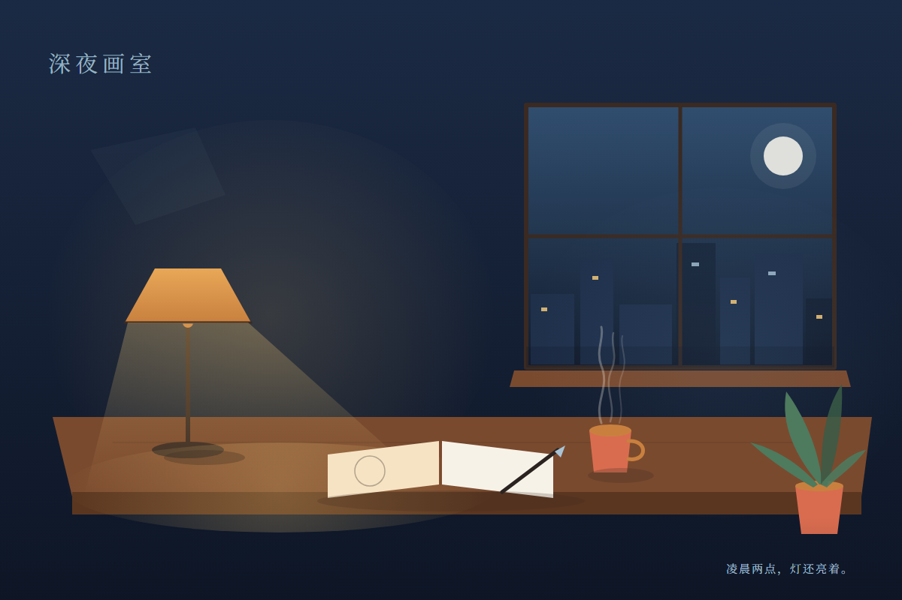

# dsh-abaaba-paint

给 DSH Agent 用的一间实时矢量画室：Agent 用工具落笔，浏览器里的画布同步显示，最后导出独立的 SVG。



示例的可恢复源文件在 `examples/night-studio.json`；工作区自动保存文件使用同一格式，文件名为 `abaaba-paint-<sessionId>.json`。

> 示例作品《深夜画室》由插件自身的 `paint_*` 工具绘制：68 个图元，1200×800。

## 兼容性

| 项 | 支持范围 |
| --- | --- |
| DSH | `0.2.1-rc.3`（已在当前 desktop profile 实测） |
| Node.js | `>=22.19.0`（DSH 桌面端自带 24.x） |
| Web UI | DSH Web profile；需要 `tools`、`connection`、`fs`、`workingDirectory` 服务 |
| 依赖 | 零运行时依赖，无安装脚本 |
| 系统 | Windows / macOS / Linux（路径逻辑按 DSH `ctx.fs` 走） |

插件在 `package.json` 中声明：

```json
"engines": { "node": ">=22.19.0", "dsh": ">=0.2.1-rc.3 <0.3.0" },
"dsh": {
  "bundle": { "patch": "./cordis.patch.yml" },
  "client": { "platform": "web", "immediately": true },
  "compatibility": { "dshReleases": { "0.2.1-rc.3": "compatible" } }
}
```

## 安装

### 通过 Plugin Manager（推荐）

把仓库克隆到本地，然后在 DSH 的 Plugin Manager 里选择 **Install bundle / 导入本地插件**，指向仓库根目录。

也可以由 Agent 调用：

```text
plugin_manager install_bundle
  target: /absolute/path/to/dsh-abaaba-paint
```

安装成功应看到 `application: applied`。不需要构建步骤。

### 手动确认

安装后检查：

- 侧栏出现「Abaaba 画室」图标
- 主面板 key 为 `abaaba-paint`
- 工具列表出现 8 个 `paint_*` 工具
- 没有 `cordis.patch.yml` 覆盖/禁用条目

## 工具

| 工具 | 作用 |
| --- | --- |
| `paint_create` | 新建/重置画布：`width`、`height`、`background`、`title`；已有快照时必须传 `replace: true` |
| `paint_draw` | 追加矢量图元，单次最多 256 个 |
| `paint_undo` | 撤销 1–50 步（历史同时受快照数和字节预算约束） |
| `paint_clear` | 清空画布（可撤销） |
| `paint_state` | 读取尺寸、标题、图元数、类型统计、revision |
| `paint_export` | 导出 SVG 到 Session 工作区，路径必须相对且以 `.svg` 结尾 |
| `paint_save` | 手动保存当前画布到工作区（正常操作会自动保存） |
| `paint_load` | 从本 Session 的工作区快照重新载入画布 |

### 推荐工作流

```text
paint_create  width=1200 height=800 background="#0E1626" title="深夜画室"
paint_draw    elements=[gradient, rect, ...]      # 先声明渐变，再画引用它的形状
paint_draw    elements=[...]                      # 分层追加
paint_state
paint_export  path="exports/night-studio.svg"
```

每次 `create` / `draw` / `undo` / `clear` 成功后都会自动写入：

- `abaaba-paint-<sessionId>.json`：该 Session 可恢复的完整画布状态
- `abaaba-paint-<sessionId>.svg`：该 Session 可直接预览的当前画面

两者都位于 Session 工作目录根部，**不同 Session 各自独立**。插件重载或 DSH 重启后，每个 Session 的下一次工具调用会读取自己的快照；画布面板按当前 Session 显示，不会串画。

### 图元词汇

`rect`、`circle`、`ellipse`、`line`、`path`、`polygon`、`text`、`gradient`。

- 颜色：`#rgb` / `#rrggbb` / `#rrggbbaa`、`none`、`transparent`，或 `url(#gradientId)`
- 渐变：`linear` / `radial`，2–8 个 stop
- 文本：纯文本，不会解释 HTML/Markdown
- 坐标单位就是 SVG 用户单位；默认画布 `1200×800`

完整参数以 Agent 看到的工具 schema 为准。

## 安全模型

- 三条同源路由全部通过 `ctx.connection.fetch`，未认证请求 401
- `GET /state`、`GET /export.svg` 无副作用；修改只走 `POST /action`
- POST 要求 `content-type: application/json`、`x-abaaba-paint: 1`、同源 Origin 和匹配的 revision
- SVG 只由白名单图元和转义文本构成；无 `script`、`foreignObject`、`href`、事件属性、`style`、远程 URL
- 客户端零 `dangerouslySetInnerHTML`、零 `eval`、零远程脚本
- 导出经 `ctx.fs.resolve + contains + lstat + writeText`，拒绝绝对路径、`..`、盘符、UNC、ADS、保留设备名和最终符号链接
- 导出使用 `ctx.sandboxPolicy.resolve()` 得到的**会话当前策略**，不会把只读会话硬编码提升为 workspace-write
- 画布状态上限 2 MB，快照文件上限 3 MB，历史上限 16 MB / 50 个快照；单次绘制最多 256 个图元
- 客户端轮询带 `ETag / If-None-Match`，未变化返回 304
- 零依赖、无 install 脚本、无子进程、无网络请求（除同源 Canvas API）

## 测试

```bash
npm run verify
```

包含：

- JavaScript 语法检查
- 29 个单元/集成测试：引擎、SVG 转义、路径穿越、路由鉴权、revision 冲突、字节预算、ETag、自动保存/重载、导出
- 本地 secret/path 扫描

CI 在 `.github/workflows/ci.yml`，使用固定 commit 的 `actions/checkout` 和 `actions/setup-node`。

## 已知限制

- 自动保存文件为工作区根部的 `abaaba-paint-<sessionId>.json` / `.svg`；手动 `paint_export` 的目标父目录必须已存在
- 画布状态会在工作区自动保存；历史撤销栈不会持久化，重载后只能从当前快照继续
- 每个 Session 独立画布；UI 按当前选中的 Session 显示
- Host 端只导出 SVG；PNG 由浏览器打开/下载 SVG 后生成
- 没有多用户协作或服务端鉴权体系，信任 DSH Web 的 owner 会话

## License

MIT。见 [LICENSE](LICENSE)。
